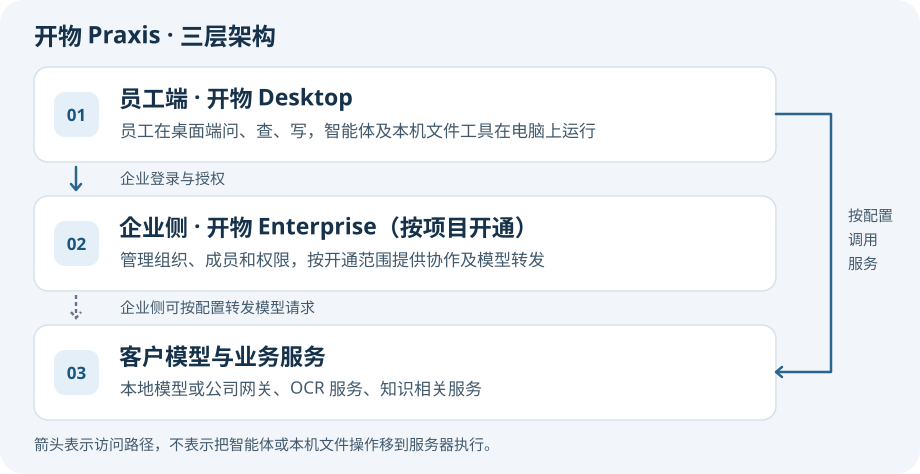

# 开物 Praxis 客户培训讲义

**讲解原则：** 只讲现场已开通、本机可演示的能力；模型回答不等于业务结论；本机运行不等于永不传输；**智算管算力与模型，开物管岗位交付，两层不要讲成同一个产品。**

**建议时长：** 90–120 分钟  
（开场组合 10 分钟 → 技术 20 分钟 → 架构 25 分钟 → 功能演示 40–50 分钟 → 答疑 15 分钟）

**建议演示机：** 已安装开物 Desktop；个人空间可进；若讲企业，需可用的企业后台、测试账号；模型尽量接客户现场或试点的**智算 / 内网推理**地址（没有则用交付指定的测试模型，并口头标明「演示地址」）。

**客户若说「要结合底层智算一起讲」：** 先用下面「〇、开物 × 智算」定分工，再进入技术 / 架构 / 功能。不要把开物讲成训练平台，也不要把智算控制台讲成员工办公工作台。

---

# 〇、开物 × 智算：客户要一起听时怎么开场

## 0.1 一句话分工（板书先写这三行）

```text
智算 / AI 专有云  →  专属环境里的算力、模型资产、推理与托管
开物 Praxis       →  员工岗位上的智能体工作台，把能力做成可交的文件
企业后台（开通时） →  组织、成员、权限、模型转发与审计入口
```

对外可复述：

> **运行资源有平台，理解问题有依据，员工使用 AI 有工具。**  
> 智算解决「卡、模型、内网推理能不能在自己院子里按权限开出来」；开物解决「业务部门按岗位验收、把结果交成文件」。

若现场品牌口径是常青云：**智算侧对应 AI 专有云（KuberCloud ANI）**；员工侧对应 **开物 Praxis**。容器云（KuberCon）只管云原生应用平台，**不替代**智算的模型仓库 / 推理托管，也**不替代**开物的岗位交付——客户没问容器云时，不必主动讲成必买。

## 0.2 两层分别解决什么、验收看什么

| | 底层智算 | 上层开物 |
| --- | --- | --- |
| 解决的问题 | 专属环境里同时保留传统业务与 AI；模型导入、版本、推理发布、配额与隔离 | 员工在本机工作台召唤数字员工 / 专家，引用资料，改稿并导出 |
| 典型听众 | 信息中心、基础设施、AI 平台负责人 | 业务骨干、办公室、部门管理员 |
| 验收口径 | 模型能部署、推理可调用、租户与密钥隔离、监控可查 | 岗位任务能做完、文件能交、权限按人可见、结论可回查原文 |
| 不要讲成 | 「员工办公聊天软件」 | 「GPU 调度 / 训练微调平台」 |

## 0.3 两条落地路径（同一套开物工作台）

| | 轻量化：开物 + 现场一体机（如 Jetson AGX Thor） | 企业级：开物 + 机房 GPU / 智算集群 |
| --- | --- | --- |
| 适合 | 一个部门、网点、关键岗位先跑通 | 多部门、统一管成员与多模型 |
| 模型与数据 | 本地模型与开物同现场设备，资料留在现场 | 多模型并存；控制台管成员、模型与审计；数据留在客户机房 |
| 演进 | 先验证岗位，再把数字员工、技能、资料迁到机房智算 | 信息部门统一运维算力与推理入口 |

路径口播：

> 客户只想一个岗位先用 AI、数据留在现场 → 一体机 + 开物。  
> 客户要多人分权、多模型、必须私有化 → 智算 / GPU 服务器 + 开物。

## 0.4 请求怎么从开物落到智算（讲技术前先画这条线）

```text
员工电脑上的开物 Desktop
    →（可选）企业后台：身份核验、内部模型 API 转发
    → 智算侧推理入口 / 模型服务（客户专属环境）
    → 返回生成结果；本机工具继续读写获准文件、导出文稿
```

要点：

1. **开物不自建训练平台**；训练 / 微调 / 模型仓库若开通，在智算侧讲，产物再作为推理服务被开物调用。  
2. **推理调用密钥 ≠ 平台登录密钥**（智算材料口径）；成员在开物里填的是获准的内部地址与内部凭证，不接触上游供应商密钥（企业开通且按交付配置时）。  
3. **登录开物企业账号 ≠ 自动配好智算模型**；仍须在「设置 → 模型 → 自定义模型 API」按交付指引填写。  
4. 知识库若在智算侧开通：依赖向量库、内网推理与租户认证**同时可用**；不要说成「任何环境都已开通知识库」。

## 0.5 组合讲解禁说（命中就改口）

- 不把开物说成智算控制台里已经内置完成的全部数字员工能力。  
- 不把智算沙箱 / Agent 隔离说成开物的岗位编排（岗位编排讲开物）。  
- 不把白皮书容量数字、故障接管秒数套到客户合同指标。  
- 不承诺等保、信创、某一款芯片已覆盖客户点名的全部设备——以现场兼容清单为准。  
- 不报价、不贬低竞品「智算平台」；对方说「智算很多」时，接法是：**智算偏算力车间；我们讲的是专属环境里卡、模型、内网推理与岗位工作台能否按权限一起开出来，而不是再立一根烟囱。**

---

# 一、技术维度：开物靠什么跑起来

## 1.1 一句话技术定位

**开物是本机运行的企业智能体工作台。**  
员工在 Desktop 里交代目标、指定资料、检查结果；智能体与工具在**员工电脑**上执行获准任务；**模型推理落在客户指定的智算 / 一体机 / 内网网关**。开物不替代 OA、公文、审批系统，也不替代经办人责任。

## 1.2 技术组成（对客户可讲清的五块）

| 组成 | 客户侧理解 | 培训时怎么说 |
| --- | --- | --- |
| Desktop 外壳 | Windows / macOS 安装的「开物Praxis」应用 | 负责窗口、启动、个人/企业入口、本机进程生命周期 |
| 本机智能体运行时 | 随安装包提供的官方运行环境与完整对话工作台 | 负责会话、工具调用、插件加载、模型路由；**不另造一套聊天壳** |
| 开物功能包 | 专家、技能、资料库、连接器等产品能力 | 在官方工作台上叠加业务能力，不是换引擎 |
| 企业后台（开通时） | 账号、组织、权限、协作数据、模型转发 | **管身份与授权**；真正干活仍在员工本机 Desktop |
| 底层智算 / 推理 | 客户专属算力与模型服务 | **提供模型资产与推理**；开物通过自定义模型 API 接入，不在开物里调度 GPU |

技术关键词（板书可用）：

1. **本机执行**：Agent、文件工具、插件进程在员工电脑上跑。  
2. **官方完整对话**：保留原生会话、设置、右侧面板；开物不复制一套侧栏/设置替代官方界面。  
3. **Profile / 工作区**：选择插件与配置；**不是账号，也不是安全边界**。  
4. **精确锁定运行时版本**：同一产品线的 Desktop 与 Web 使用同一官方运行时版本族；升级以现场安装包验收为准。  
5. **算力在智算、岗位在开物**：GPU / 模型托管归智算；数字员工、资料、导出归开物。

## 1.3 数据与请求会去哪里（必须讲清楚）

| 类型 | 常见位置 | 说明 |
| --- | --- | --- |
| 本机读写的文件、个人工作区数据 | 员工电脑用户数据目录 | 个人与企业空间目录隔离 |
| 模型请求 | **智算推理入口** / 公司内网模型网关 / 一体机本机模型 | **登录企业 ≠ 自动配好模型**；需在「设置 → 模型 → 自定义模型 API」按交付指引填写 |
| OCR / 知识库 / MCP 等 | 现场接入的服务地址（可能同在智算或业务网） | 能否外传、传什么，由接入配置与单位制度决定 |
| 企业可见正文同步（开通时） | 企业后台 | 仅同步**已提交的可见用户/助手正文**；工具轨迹、思考、未分享文件、凭据不在此列；**不是不可绕过的全终端审计** |

**纠正一句营销简化说法：**  
启动页有「本机运行」的表述，培训时应补一句——**本机执行工具 ≠ 离线、≠ 永不向获准的智算推理发请求**。敏感材料先核对服务与分享范围。

## 1.4 安全与权限的技术边界（讲真的，不要夸大）

- **个人空间 / 企业空间相互隔离**：配置、凭据、技能根、窗口存储分开；个人练习数据不会因后来登录企业而自动迁入。  
- **企业权限由后台核验**：安装企业插件 ≠ 获得成员资格或业务权限。  
- **目录分开 ≠ 操作系统沙箱**：同一 Windows/macOS 用户下的目录隔离，不能当成跨用户安全沙箱来承诺。  
- **凭据分层**：智算平台访问密钥、推理调用密钥、开物企业登录、模型页内部 Key——用途不同，不要混成一把万能钥匙。  
- **凭据不进页面与提示词**：企业登录凭据留在 Desktop 主进程；模型 Key 由成员在官方模型页自行配置，不写进业务文稿。  
- **管理员看会话**：须后台显式授权、只读、留审计；普通成员不能靠切账号看他人会话。

## 1.5 技术答疑备用句

- **问：是不是云端 SaaS？**  
  员工日常干活在本机 Desktop；企业后台负责账号与授权；模型推理可落在客户专属智算环境。是否连公网，取决于现场怎么接。  
- **问：和普通聊天工具差在哪？**  
  同一任务可接资料、技能、专家、连接器；按单位规定接智算上的模型与服务；关键回答应能回到资料原文核对。  
- **问：会不会替我们训模型？**  
  开物不负责训练。若合同含训练 / 微调，在智算侧讲；开物只接入已发布的推理服务。  
- **问：买了智算还要开物吗？**  
  智算解决「有没有可管的算力与模型」；开物解决「业务岗能不能按岗位把事做完并交文件」。可以只买一层，但验收对象不同。  
- **问：和市面上其他智算平台比呢？**  
  不贬低对方调度能力。强调组合：专属环境里传统业务与 AI 同底座，再加员工侧岗位工作台，减少「云一套 + 智算一套 + 办公助手又一套」。

---

# 二、架构维度：谁在哪操作、谁管什么

{width=95%}

## 2.1 三层架构（核心板书）

### 第一层｜员工端：开物 Desktop

- 选资料、提要求、看引用、改文稿，都在这里。  
- 本机文件读写、本机工具执行在员工电脑完成。  
- 需要识别、检索、调用业务 MCP 时，按现场配置发起请求。

### 第二层｜企业侧：开物企业后台（开通企业时）

- 管理组织、成员、权限；员工用企业账号登录 Desktop。  
- **后台决定「谁能以什么身份用」；Desktop 才是办事的地方。**  
- 协作等能力以现场授权与插件开通为准，不因同组织就默认共享个人会话或本机文件。

### 第三层｜智算 / 客户模型与业务服务

这一层就是客户说的「底层智算」常落脚的位置：算力与模型在专属环境，开物只作为调用方。

| 服务 | 职责 | 常见误判 |
| --- | --- | --- |
| 智算底座 | GPU/异构算力、租户网络、配额与托管 | 有卡 ≠ 岗位已经能用 |
| 模型资产与推理 | 导入、版本、发布、内网推理入口 | 模型已部署 ≠ 开物已配好 |
| OCR / 识别 | 图像转可处理文本 | 识别错字 ≠ 模型坏了 |
| 知识 / 资料服务 | 按权限检索依据（若现场开通） | 库里找得到 ≠ 解释一定对 |
| MCP / 连接器 | 对接单位系统或外部工具 | 能查 ≠ 能写 |

模型可运行在一体机、机房 GPU 或智算推理入口上；管理员给出批准的 API 地址、协议、内部 Key、模型标识，使用人在开物手工配置。**企业账号、智算平台账号、推理调用密钥不是同一回事。**

## 2.2 个人空间与企业空间

```text
开物 Desktop
├── 个人使用：本机个人工作区（无需企业账号）
└── 企业登录：独立成员空间（后台核验组织与成员）
```

讲解要点：

1. **练习用个人，正式业务用企业。**  
2. 同一台电脑上也不要用个人空间绕过企业授权。  
3. 企业执行在本机；服务器不做「远程替员工跑会话」的替代路径（Desktop 企业模式不以远端 Web 会话代替本机执行）。  
4. 离线/内网场景：可用管理员通过可信渠道下发的企业连接文件（`.praxis`）导入并验证后台地址；验证成功后再登录。证书用途仅限该企业后台，不装进系统信任库，也不用于单独配置的模型 API。

## 2.3 功能在架构上的位置（避免讲成「什么都能默认装」）

| 类别 | 典型能力 | 交付说法 |
| --- | --- | --- |
| 默认自有能力 | 专家、技能、资料库、MCP/连接器 | 产品自带管理与使用入口；**不预装客户自定义的全部专家/技能/服务** |
| 按包选装 | Office、协同空间/项目、活动、质量分析等 | 以现场安装包与插件清单为准 |
| 企业相关 | 企业账号、协作、通知、业务应用 | 企业连接等为独立归档/显式安装；个人模式不激活企业身份与协作 |
| 第三方目录 | SkillHub、插件市场等 | **可浏览 ≠ 已审核、≠ 自动安装、≠ 兼容保证** |

## 2.4 端到端一条请求路径（用业务例子讲）

**例子：起草报送通知**

1. 员工在 Desktop 企业空间打开任务，选定扫描件与制度资料。  
2. 本机工具读取已授权文件；如需 OCR，请求发往现场识别服务。  
3. 模型按已配置的公司模型生成提纲/初稿。  
4. 员工核对引用条款，修改正文；导出后仍走单位 OA/核稿流程。  
5. 若开通正文同步，仅已提交可见正文可按规则进入后台只读查阅（须授权与审计）。

板书一句话：

> **人在桌面决策 → 智能体在本机执行 → 智算侧模型按授权被调用 → 审批仍走原系统。**

若听众是信息部门，可多补半句：

> **智算验收「推理通不通」；开物验收「岗位交不交得出文件」。两层门禁都过，才叫组合落地。**

---

# 三、功能使用：现场怎么操作

> 按钮文案以现场版本为准。下列路径来自当前产品设计与交付文档；演示前用交付包走通一遍。

## 3.1 第一次打开：选择使用方式

1. 启动「开物Praxis」。  
2. 在「选择使用方式」中选：  
   - **个人使用**：直接进本机个人工作区，无需账号。  
   - **企业登录**：连接企业后台，使用企业空间与统一权限。  
3. 企业未装插件时，入口会提示先到个人空间安装企业账号插件，再切换企业登录。  
4. 等待「正在启动个人/企业工作区」完成后进入工作台。

**演示注意：** 启动页步骤文案是引导界面；若长时间停住，不要当场断言「卡在第一步」，先看是否有报错弹窗，再查本机日志（见附录）。

## 3.2 配置模型（正式演示前必做；结合智算时重点讲）

路径：**设置 → 模型 → 自定义模型 API**

填写交付提供的（通常来自智算 / 企业后台发出的**内部推理入口**，不是公有云控制台随便抄的地址）：

- API 地址（智算推理或企业转发地址）  
- 协议  
- 内部访问密钥（推理调用凭证；与智算平台登录口令分开）  
- 模型标识（以智算模型仓库 / 已发布服务名为准）  

核对方式：发一条短问题，确认所选模型能响应。  
口播建议：

> 「刚才智算侧已经能部署和发布模型；现在开物只做一件事——把员工岗位接到这个推理入口。配通了，业务才能在工作台里验收。」

**不要把 Key 写进对话、截图发群或贴进文稿。**  
现场若暂时接公网测试模型，必须口头标明「仅演示，生产以客户智算入口为准」。

## 3.3 对话工作台：主路径

建议演示话术（可原样用）：

> 「先把扫描件里的报送要求列出来，再对照制度区分哪些有依据，最后给我一份通知提纲。有冲突的标成待确认，不要自行定论。」

操作要点：

1. 新建或打开会话。  
2. 用附件 / 资料引用把材料绑到任务。  
3. 看回复中的来源/引用，点回原文核对版本与适用对象。  
4. 人改提纲或初稿后，若继续让模型润色，**基于最新稿**，避免改回旧版。  
5. 导出可编辑稿后，仍按单位核稿、审批流程办理。

**人机分工（每次培训重复一遍）：**

| 适合交给开物协助 | 必须由人核定 | 仍走原流程 |
| --- | --- | --- |
| 提取扫描正文、整理要点 | 制度解释、密级、文号、对外口径 | 审批、会签、签发、归档 |
| 按问题查找条款 | 冲突材料、来源不明、关键字段不清 | OA / 公文系统 |
| 提纲、初稿、改写建议 | 是否可送审的最终责任 |  |

## 3.4 专家

**讲什么：** 专家是可管理、可发布的业务角色资产；发布后任务绑定该版本，改草稿不会悄悄改已发布定义。团队执行复用官方 Agent Teams 能力（多成员协作以现场是否开通与验收为准）。

**建议演示：**

1. 打开专家相关入口（能力中心 / 专家页，以现场菜单为准）。  
2. 查看已有专家或按交付样例打开一个专家。  
3. 从对话召唤专家完成一个小任务（例如「根据已选制度列报送对象清单」）。  
4. 强调：专家发布修订不可变；旧任务不因你改草稿而静默变样。

**不要承诺：** 「所有行业专家已预装」「专家团任意场景已全量验收」。只演示交付包里实际有的。

## 3.5 技能（Skill）

**讲什么：** 技能是可安装、启停、导入的操作指南与资源；管理页管的是技能对象，执行仍走官方 Skill 运行时。

**建议演示：**

1. 打开技能管理页。  
2. 展示已安装技能列表；说明浏览第三方目录 ≠ 自动安装。  
3. 启用一个与演示相关的技能，在对话中触发一次。  
4. 如需新建：走产品提供的创建/导入流程，**导入不执行脚本**。

## 3.6 资料库

**讲什么：** 资料有单一正文源与修订；对话引用的是明确版本，不是「文件夹随便翻」。

**建议演示：**

1. 导入一份制度 MD/PDF/Office 文件（按现场支持格式）。  
2. 在目录树中定位，添加到当前任务。  
3. 提问后从回答回到资料位置核对。  
4. 说明：停用资料会阻断历史任务继续读取正文；大文件有容量上限（交付说明为准，常见单文件约 50 MiB 量级）。

## 3.7 连接器（MCP）

**讲什么：** 连接器把外部工具以 MCP 方式接到会话；**全局启用**与**当前会话是否选用**是两件事。新会话默认不带连接器，需在输入区显式选择。

**建议演示（可用交付文档中的 LibTV 生图例子，若现场已开通）：**

1. 对话输入框左侧打开「连接器」，或侧栏「专家 · 技能 · 连接器」→「连接器」。  
2. 进入「MCP 服务管理」。  
3. 编辑/添加服务：显示名称、标识、传输方式（远程常用 **Streamable HTTP**）、URL、访问令牌。  
4. 健康检查通过后，在**当前会话**勾选该连接器。  
5. 发一条会真正调用工具的指令，确认有真实工具结果，而不是模型嘴上说「已完成」。

令牌处理：**不进群、不进清晰截图、不写进公开培训稿。**

详细逐步说明见同目录：[`mcp-connector-howto.zh-CN.md`](mcp-connector-howto.zh-CN.md)。

## 3.8 协同空间 / 项目（若现场已装）

**讲什么：** 把指令、技能、专家、连接器、资料引用和任务组织在同一协同空间；**不复制**各领域权威数据。配置保存生成修订，新任务固定创建时的能力快照。

**建议演示：**

1. 打开协同空间中心，新建或进入示例空间。  
2. 在配置中挂上演示用的技能/专家/资料。  
3. 新建任务进入原生会话，强调旧任务仍引用旧配置修订。  
4. 说明：协同空间 ≠ 自动把所有会话共享给全员。

## 3.9 Office 与文稿（若现场已装）

按开通范围演示预览/编辑/导出之一即可。  
培训口径：

- 浏览器内工作副本与导出，**不依赖本机安装 Microsoft Office** 作为运行前提（与单位是否另装 Office 无关）。  
- 复杂版式、旧格式（如 `.doc`）、密码文档等保真能力以现场版本说明为准，**不要承诺「任意 Word/PPT 完美往返」**。

## 3.10 企业登录与退出（开通企业时）

1. 确认企业插件已安装且版本兼容。  
2. 选择企业登录 → 确认后台地址（预置或导入 `.praxis`）→ 账号密码登录。  
3. 登录后核验：组织名称、当前为企业空间、模型仍需按指引配置。  
4. 退出：先停本机企业运行与登录；若提示远端撤销未确认，本机仍应已停止，按提示检查即可。  
5. 个人与成员业务数据保留；不要把「退出」理解成「清空本机所有资料」。

**双账号权限演示（强烈建议）：**

- 账号 A：有某制度库权限 → 可检索到内容。  
- 账号 B：无该库权限 → 同一问题不应因聊天而读到受限库正文。

---

# 四、建议现场议程（可直接当讲稿目录）

| 时间 | 环节 | 目标 |
| --- | --- | --- |
| 0–10′ | 开场：开物 × 智算分工 + 业务案例 | 先定两层分工，再建立「协助办事、人做决断」 |
| 10–30′ | 技术维度 | 本机执行、请求落到智算、密钥分层、传输边界 |
| 30–55′ | 架构维度 | 三层架构（含智算）、个人/企业、轻量一体机 vs 机房集群 |
| 55–100′ | 功能使用演示 | 接智算模型 → 对话 → 资料 → 技能/专家 → 连接器 →（企业） |
| 100–120′ | 答疑与注意事项 | 组合选型、禁说清单、日志与升级 |

**若总时长只有 60 分钟：** 〇节 8′ + 架构精简 12′ + 接模型与一条完整任务演示 30′ + 答疑 10′；技术细节改为附录自读。

---

# 五、附录

## A. 讲解禁区（避免明天讲错）

1. 不要说「装了就自动有公司全部知识库/模型」。  
2. 不要说「本机运行所以数据绝不会离开电脑」。  
3. 不要说「浏览 SkillHub/市场里的条目都已官方审核」。  
4. 不要把 Web 预览、开发包能力说成 Desktop 现场已交付。  
5. 不要把模型通顺的回答当成已核稿公文。  
6. 用户可见文案与口播使用 **开物 / 开物Praxis**，不要把内部工程名当产品对外品牌讲解。  
7. 不要把开物讲成智算训练 / GPU 调度产品；也不要把智算控制台讲成员工岗位工作台。  
8. 不要把「智算推理已通」直接说成「开物岗位已验收」——两层分别验收。

## B. 启动失败时（培训机应急）

1. 看是否有「无法进入 / 启动超时 / 本机运行已停止」弹窗，先记完整正文。  
2. Windows 可在运行对话框打开：`%APPDATA%\kaiwu\logs`  
   关注 `runtime-failure.log`、`plugin-operation-failure.log`。  
3. 先不要删除整个 `%APPDATA%\kaiwu`（内含个人工作区数据）；重启后再试。  
4. SkillHub 一类「自检超时、不影响使用」的日志，**不能单独当成启动失败根因**。

## C. 与第一部分产品定位的关系

若需先讲「解决什么问题、适合/不适合交给智能体」，可继续使用本文历史第一节口径，核心三句不变：

1. 把分散步骤接到同一任务上。  
2. 按单位规定使用模型与资料。  
3. 同事必须能复核依据；开物输出是可核稿草稿，审批仍走原流程。

---

**文档维护：** `apps/desktop/docs/customer-delivery-training.zh-CN.md`  
**连接器操作细案：** `apps/desktop/docs/mcp-connector-howto.zh-CN.md`  
**架构图：** `apps/desktop/docs/assets/customer-training-architecture.svg`  
**智算 / 组合口径依据（售前材料摘要）：** `packages/plugins/skills/resources/skills/changqingyun-product-intro/references/`（`portfolio.md`、`ai-private-cloud.md`、`kaiwu-praxis.md`、`demo-and-boundaries.md`）  
**现场以安装包版本、企业开通范围、智算开通清单与合同为准。**
